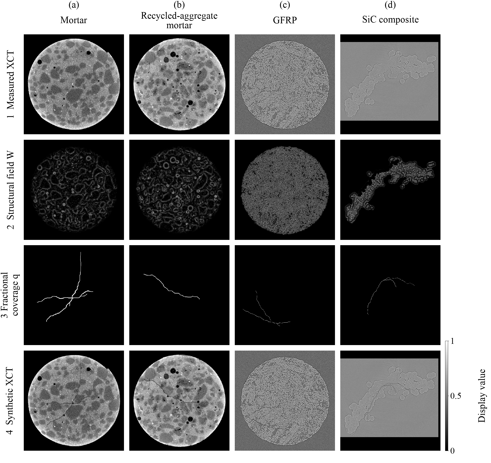
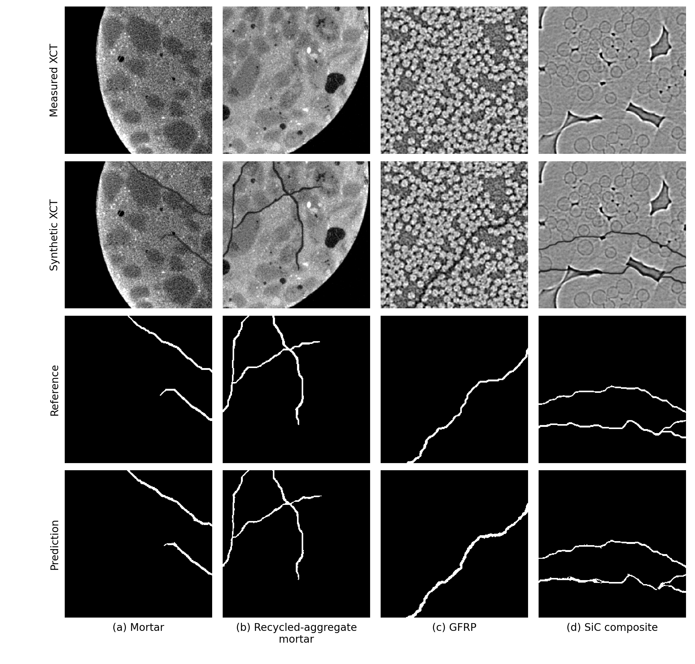
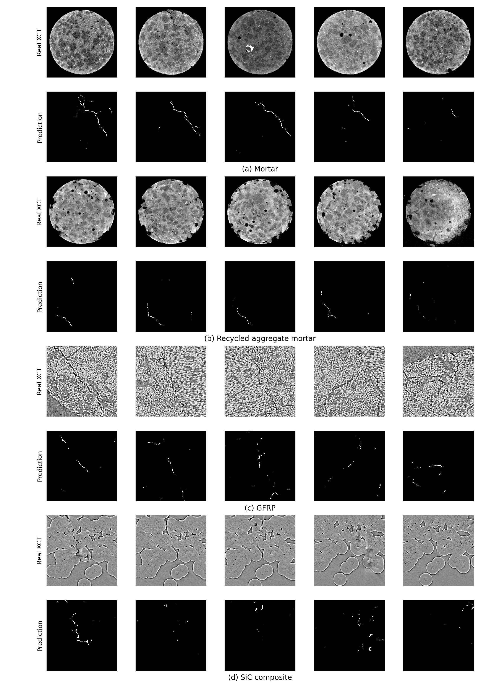
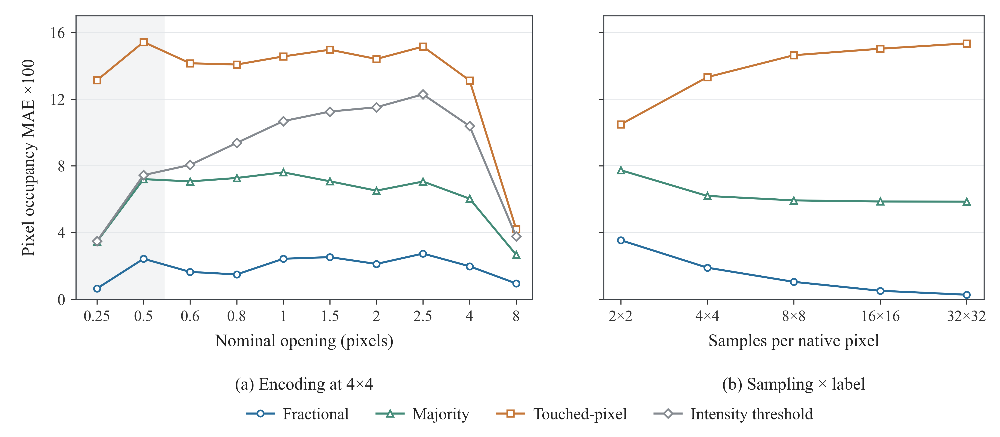
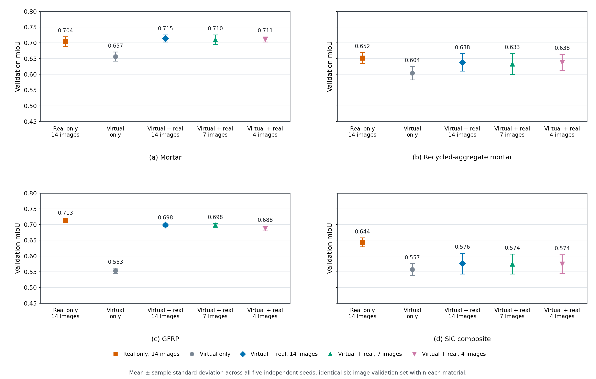

# Image-informed virtual cracks for XCT segmentation

Generate controlled virtual damage in native X-ray computed tomography (XCT) images, retain the measured material texture, and train material-specific segmentation models with geometric supervision.

This research snapshot accompanies manuscript revision **vn46**. It combines the original **V45 development models** with a separately reported **five-seed real-image adaptation study**. The repository is initially private.

[Method](docs/method.md) · [Usage](docs/usage.md) · [Data and models](docs/data-and-models.md) · [Study provenance](research/table5/README.md)



## What the method provides

- **Image-informed geometry.** Native image structure guides crack routes; local aperture and branching vary along each path.
- **Controlled appearance.** A blurred intensity decrement introduces damage without resampling or re-blurring the measured background image.
- **Paired supervision.** Subpixel geometric coverage defines the target independently of the rendered grey-value tail.
- **Material-specific learning.** Compact 2D U-Nets cover Mortar, Recycled-aggregate mortar, GFRP and SiC composite. Both the fibres and matrix of the SiC composite are silicon carbide.
- **Small-label adaptation.** Virtual pretraining can be followed by fine-tuning on a small set of annotated real images. The measured benefit depends on the material.

## Visual results

### Synthetic segmentation



These examples use the original V45 synthetic-only development models, corresponding to manuscript Table 4 and Figure 7.

### Transfer to real XCT images



These qualitative examples use the original V45 models, corresponding to manuscript Figure 8. The quantitative adaptation results below come from a separate set of models.

### Geometric encoding



Geometric coverage measures the injected support at native pixel resolution. Its encoding fidelity is a different quantity from learned segmentation accuracy.

## Real-image validation: all five seeds

All schemes use the same six complete validation images per material. Each value is **mIoU mean ± sample standard deviation over all five independent seeds**. The real fitting pool contains 14 images, with fixed nested 7- and 4-image subsets. Training uses native **256 × 256** windows and Apple **MPS**.

| Training scheme | Mortar | Recycled-aggregate mortar | GFRP | SiC composite |
|---|---:|---:|---:|---:|
| Real only, 14 images | 0.7039 ± 0.0155 | **0.6521 ± 0.0176** | **0.7129 ± 0.0044** | **0.6436 ± 0.0143** |
| Virtual only | 0.6565 ± 0.0146 | 0.6037 ± 0.0213 | 0.5530 ± 0.0083 | 0.5573 ± 0.0185 |
| Virtual + real, 14 images | **0.7145 ± 0.0113** | 0.6382 ± 0.0276 | 0.6985 ± 0.0040 | 0.5759 ± 0.0332 |
| Virtual + real, 7 images | 0.7102 ± 0.0154 | 0.6330 ± 0.0336 | 0.6982 ± 0.0056 | 0.5744 ± 0.0318 |
| Virtual + real, 4 images | 0.7111 ± 0.0082 | 0.6383 ± 0.0253 | 0.6885 ± 0.0058 | 0.5743 ± 0.0303 |



Virtual-only training comes within **4.74 and 4.84 percentage points** of the 14-image real-only reference for the two mortar materials. With four annotated fitting images, Mortar reaches **0.7111**, compared with **0.7039** for real-only training on 14 images. GFRP gains **13.55 percentage points** over virtual-only training with four-image fine-tuning. These results support virtual data as a useful initialisation for material-dependent adaptation; SiC retains a larger gap to real-only training.

The six real validation images also select checkpoints. These are development-validation results on correlated slices from the same acquisitions, rather than an independent test. Matched real-only 4- and 7-image controls were not included, so the comparison does not establish a general annotation-saving rate. Bold identifies the highest mean, without a statistical-significance claim.

Data: [full-five summaries](results/validation_miou_all_five.csv), [all 100 seedwise scores](results/seedwise_miou.csv), [protocol](research/table5/protocol.json), and [fixed fitting/validation identities](research/table5/fixed_split.csv).

## Quick start

Use Python 3.10 (the research environment) or a supported Python 3.11–3.12 environment. Install the package in a dedicated environment:

```bash
python -m pip install -e .
python scripts/generate_demo.py --output runs/demo --seed 271
```

The default demo creates a **procedural 256 × 256 background** and applies the original geometric routing, coverage rasterisation and grey rendering. It demonstrates the software and is not an experimental XCT sample or a reproduction of the validation table.

To use a two-dimensional XCT TIFF and a specimen-support mask:

```bash
python scripts/generate_demo.py \
  --input path/to/slice.tiff \
  --mask path/to/specimen-mask.tiff \
  --output runs/my-slice \
  --seed 271
```

See [installation and use](docs/usage.md) for input conventions and outputs.

## MPS training and inference

All neural commands require an Apple Silicon Mac with working PyTorch MPS. They check actual tensor allocation and a forward/backward pass, and stop if MPS is unavailable.

Run inference with a supplied V45 checkpoint:

```bash
python scripts/infer_mps.py \
  --input path/to/slice.tiff \
  --checkpoint models/v45/mortar.pt \
  --material mortar \
  --output runs/inference \
  --batch-size 8
```

Train on a prepared paired dataset:

```bash
python scripts/train_mps.py \
  --dataset path/to/prepared-dataset \
  --material mortar \
  --output runs/mortar \
  --batch-size 8
```

This is a portable training entry point for the supplied dataset format, **not** an automatic replay of all 100 historical fits. The published Table 5 experiment used batch size 4. Its archived implementation and data dependencies are described in [research provenance](research/table5/README.md).

## Repository guide

| Location | Contents |
|---|---|
| `src/xct_cracks/` | Portable original geometry, rendering, input handling and model components |
| `scripts/` | Generation demo and MPS-only neural entry points |
| `models/v45/` | Four original development checkpoints |
| `docs/` | Method, use, visual examples and provenance |
| `results/` | Full-five mIoU summaries and all individual scores |
| `research/table5/` | Fixed protocol, split and historical source snapshots |
| `tests/` | Geometry and packaging checks without neural training |

## Data and availability

Full experimental volumes, human annotation masks and large derived training caches are not bundled. The GFRP source is available through [Zenodo](https://doi.org/10.5281/zenodo.13348028); the SiC composite source is available through [Dryad](https://doi.org/10.5061/dryad.9cnp5hqsm). Use each source under its own terms. See [data and model availability](docs/data-and-models.md).

The paper is in preparation. This snapshot has no publication DOI and does not grant an open-source licence. See [NOTICE](NOTICE).
